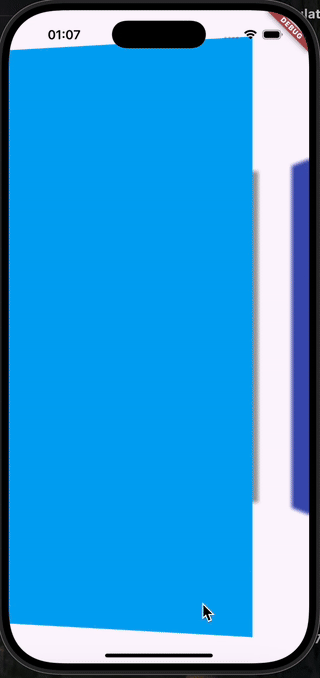
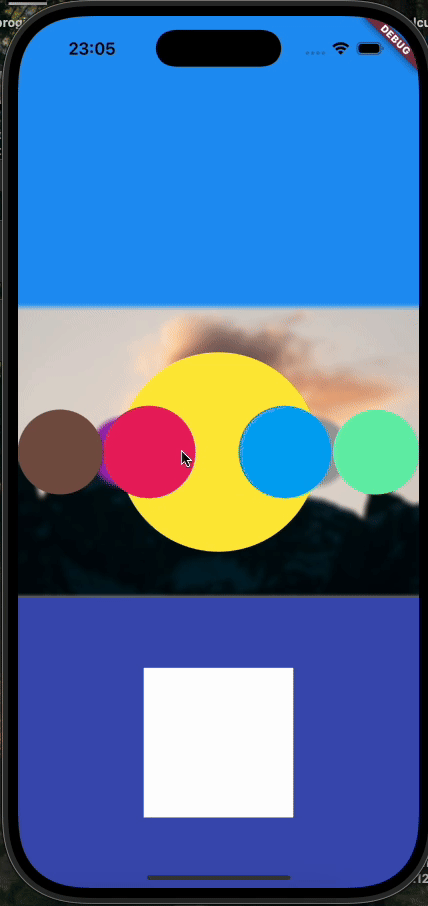
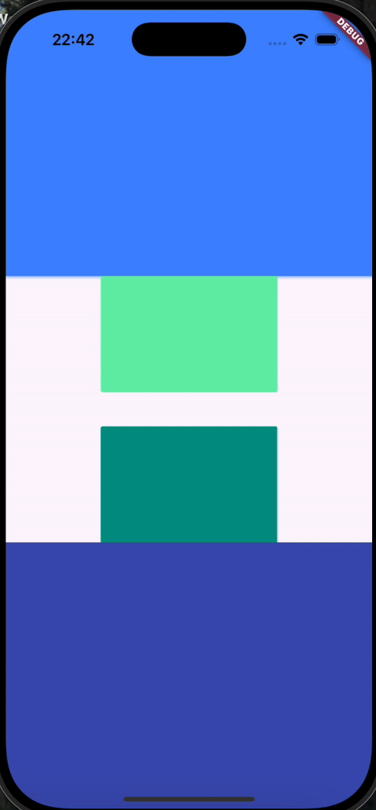

# flutter_3d_carousel

This is a 3d carousel animation project built in flutter.
The carousel has 3 degrees of freedom (DoF); roll, pitch, and yaw. The package can be used in many ways: simple and complex.
The 3D carousel responds to button clicks and swipes and can rotate infinitely. It is implemented natively in flutter. No external dependencies are used.

Check out the article for more information and examples to understand how the package works: 

TODO: Link the article

NOTE: The BoxConstraint will force an infinite width and height if you don't constrain the carousel. Give it explicit dimensions or use a widget like Expanded to avoid this error.

## Example:

### Basic Example:

```dart
  @override
  Widget build(BuildContext context) {
    return CarouselWidget3D(
      radius: MediaQuery.sizeOf(context).width / 2,
      children: List.generate(6, (index) {
        return CarouselChild(
          child: Container(
            width: 300,
            height: 300,
            color: colors[index],
          ),
        );
      }),
    );
  }

  List<Color> colors = [
    Colors.lightBlue,
    Colors.greenAccent,
    Colors.indigo,
    Colors.grey,
    Colors.yellow,
    Colors.purple,
  ];
```


### Example 1

```dart
import 'package:flutter/material.dart';
import 'package:flutter_3d_carousel/flutter_3d_carousel.dart';

class Example1 extends StatelessWidget {
  const Example1({super.key});

  @override
  Widget build(BuildContext context) {
    return Scaffold(
      body: CarouselWidget3D(
        radius: MediaQuery.sizeOf(context).width,
        childScale: 0.9,
        dragEndBehavior: DragEndBehavior.snapToNearest,
        backgroundTapBehavior: BackgroundTapBehavior.startAndSnapToNearest,
        childTapBehavior: ChildTapBehavior.transparent,
        isDragInteractive: true,
        onlyRenderForeground: false,
        clockwise: false,
        backgroundBlur: 3,
        spinWhileRotating: true,
        shouldRotate: true,
        timeForFullRevolution: 20000,
        snapTimeInMillis: 100,
        perspectiveStrength: 0.001,
        dragSensitivity: 1.0,
        onValueChanged: (newValue) {
          print(newValue);
        },
        background: null,
        core: null,
        children: List.generate(
          colors.length,
              (index) => CarouselChild(
            child: Container(
              width: MediaQuery.sizeOf(context).width,
              height: MediaQuery.sizeOf(context).height,
              color: colors[index],
            ),
          ),
        ),
      ),
    );
  }
}

List<Color> colors = [
  Colors.lightBlue,
  Colors.greenAccent,
  Colors.indigo,
  Colors.grey,
  Colors.yellow,
  Colors.purple,
];

```

### Example 1 Screen Recording

 


### Example 2

```dart
import 'package:flutter/material.dart';
import 'package:flutter_3d_carousel/flutter_3d_carousel.dart';

class Example2 extends StatefulWidget {
  const Example2({super.key});

  @override
  State<Example2> createState() => _Example2State();
}

class _Example2State extends State<Example2> {
  Color? selectedColor;

  @override
  Widget build(BuildContext context) {
    return Scaffold(
      body: Column(
        children: [
          Expanded(child: Container(color: Colors.blue)),
          Expanded(
            child: CarouselWidget3D(
              radius: MediaQuery.sizeOf(context).width / 2,
              childScale: 0.7,
              dragEndBehavior: DragEndBehavior.snapToNearest,
              backgroundTapBehavior:
                  BackgroundTapBehavior.startAndSnapToNearest,
              childTapBehavior: ChildTapBehavior.stopAndSnapToChild,
              isDragInteractive: true,
              onlyRenderForeground: false,
              clockwise: false,
              backgroundBlur: 3,
              spinWhileRotating: false,
              shouldRotate: true,
              timeForFullRevolution: 12000,
              snapTimeInMillis: 100,
              perspectiveStrength: 0.001,
              dragSensitivity: 1.5,
              onValueChanged: (newValue) {
                // print(newValue);
              },
              background: Image.asset(
                'assets/images/background_1.jpg',
                fit: BoxFit.cover,
              ),
              core: Container(
                width: 200,
                height: 200,
                decoration: BoxDecoration(
                  shape: BoxShape.circle,
                  color: Colors.yellow,
                ),
              ),
              children: List.generate(colors.length, (index) {
                return CarouselChild(
                  child: Container(
                    width: MediaQuery.sizeOf(context).width / 3,
                    height: MediaQuery.sizeOf(context).height / 3,
                    decoration: BoxDecoration(
                      color: colors[index],
                      shape: BoxShape.circle,
                    ),
                  ),
                  onTap: () {
                    setState(() {
                      selectedColor = colors[index];
                    });
                  },
                );
              }),
            ),
          ),
          Expanded(
            child: Container(
              color: Colors.indigo,
              alignment: Alignment.center,
              child: Container(
                width: 150,
                height: 150,
                color: selectedColor ?? Colors.white,
              ),
            ),
          ),
        ],
      ),
    );
  }
}

List<Color> colors = [
  Colors.lightBlue,
  Colors.greenAccent,
  Colors.teal,
  Colors.grey,
  Colors.orangeAccent,
  Colors.purple,
  Colors.red,
  Colors.brown,
  Colors.pink,
];

```

### Example 2 Screen Recording

 


### Example 3

```dart
import 'package:flutter/material.dart';
import 'package:flutter_3d_carousel/flutter_3d_carousel.dart';

class Example3 extends StatelessWidget {
  const Example3({super.key});

  @override
  Widget build(BuildContext context) {
    return Scaffold(
      body: Column(
        children: [
          Expanded(child: Container(color: Colors.blueAccent)),
          Expanded(
            child: CarouselWidget3D(
              radius: MediaQuery.sizeOf(context).width * 0.6,
              onlyRenderForeground: true,
              spinWhileRotating: false,
              shouldRotate: true,
              spinAxis: Axis.vertical,
              timeForFullRevolution: 20000,
              perspectiveStrength: 0.002,
              dragSensitivity: 1.5,
              children: List.generate(colors.length, (index) {
                return CarouselChild(
                  child: Container(
                    width: MediaQuery.sizeOf(context).width * 3,
                    height: MediaQuery.sizeOf(context).width * 2,
                    decoration: BoxDecoration(
                      color: colors[index],
                      borderRadius: BorderRadius.circular(4),
                    ),
                  ),
                );
              }),
            ),
          ),
          Expanded(child: Container(color: Colors.indigo)),
        ],
      ),
    );
  }
}

List<Color> colors = [
  Colors.lightBlue,
  Colors.greenAccent,
  Colors.teal,
  Colors.orangeAccent,
  Colors.purple,
  Colors.red,
  Colors.brown,
  Colors.pink,
];

```

### Example 3 Screen Recording

 

## Issues
- Snapping should bring the item to the center of the carousel, to the closest location to the user. It can be implemented in different ways, that is, in what axis position should the carousel come to rest in? For now, only snapping to horizontal and vertical axes are implemented. We can add more customization options later for the user to define the behaviour. Perfect is the enemy of done.
- Are there too many properties? Is there a way to group them?
- The carousel can be more efficient algorithmically.

## Ideas for features to add:

Ideas and feature requests are welcome. Here are some ideas for future updates:

- Show guiding X, Y, and Z axes for debugging and demonstration to show the motion.
- Programmatically freeze or move to the next and previous object in the carousel from outside.
- Add option to show only some of the children to the carousel. For example, 100 children, show 12.
- Animating the orientation of the children.
- Combining X, Y, and Z child orientations.

## Contributing
Contributions from anyone are welcome. To contribute to the project, please follow these steps:
- Fork the repository.
- Create a new branch for your feature or bugfix.
- Make your changes and commit them.
- Push your changes to your forked repository.
- Open a pull request against the main branch of this repository.

Please ensure that your code follows the project's coding standards and includes appropriate tests.
