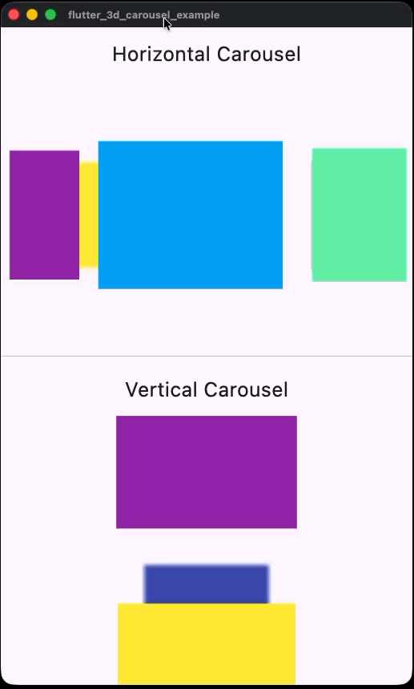
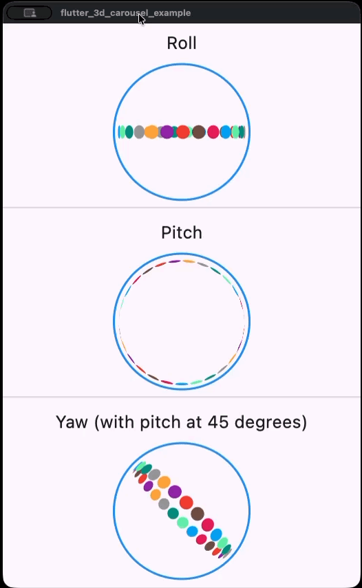
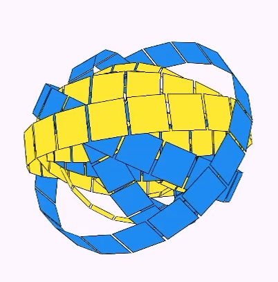
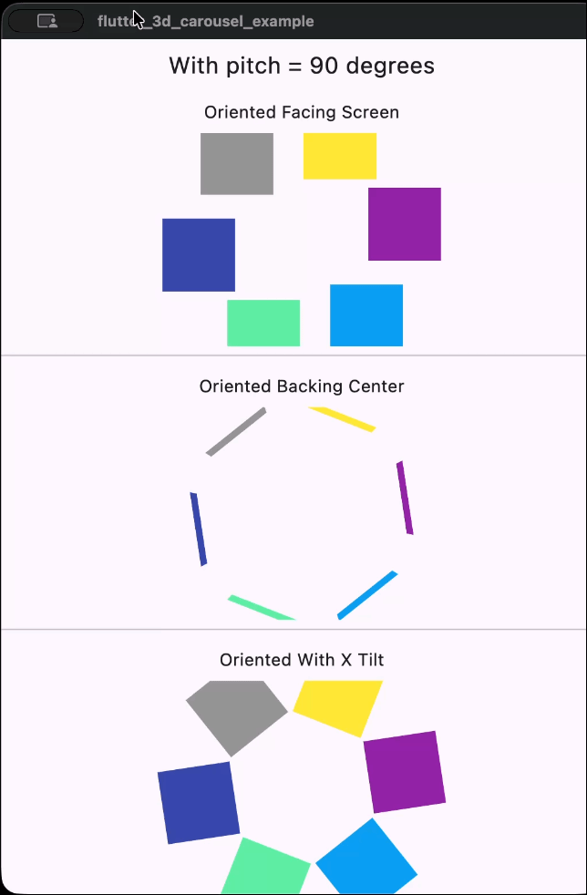

# flutter_3d_carousel

This is a 3d carousel animation project built in flutter.
The carousel has 3 degrees of freedom (DoF); roll, pitch, and yaw. The package can be used in many ways: simple and complex.
The 3D carousel responds to button clicks and swipes and can rotate infinitely. It is implemented natively in flutter. No external dependencies are used.

Check out the article for more information and examples to understand how the package works: https://medium.com/@olumideolubosede/flutter-3d-carousel-explainer-article-69686e0ecf9c

NOTE: The BoxConstraint will force an infinite width and height if you don't constrain the carousel. Give it explicit dimensions or use a widget like Expanded to avoid this error.

## Examples:

### Example 1:

```dart
CarouselWidget3D.horizontal(
  radius: MediaQuery.sizeOf(context).width / 2,
  roll: LinearInputFunction(gradient: math.pi / 12),
  children: List.generate(
    colors.length,
    (index) => CarouselChild(
      child: Container(
        width: MediaQuery.sizeOf(context).width / 2,
        height: MediaQuery.sizeOf(context).height / 4,
        color: colors[index],
      ),
    ),
  ),
)
```
```dart
CarouselWidget3D.vertical(
  radius: MediaQuery.sizeOf(context).width / 2,
  roll: LinearInputFunction(gradient: math.pi / 12),
  children: List.generate(
    colors.length,
    (index) => CarouselChild(
      child: Container(
        width: MediaQuery.sizeOf(context).width / 2,
        height: MediaQuery.sizeOf(context).height / 4,
        color: colors[index],
      ),
    ),
  ),
)
```

 

 

 



More demos can be found in this repo: https://github.com/LordOlumide/flutter_3d_carousel_example

## Issues
- Snapping should bring the item to the center of the carousel, to the closest location to the user. It can be implemented in different ways, that is, in what axis position should the carousel come to rest in? For now, only snapping to horizontal and vertical axes are implemented. We can add more customization options later for the user to define the behaviour. Perfect is the enemy of done.
- Are there too many properties? Is there a way to group them?
- The carousel can be more efficient algorithmically.
- Make it possible to use ChildOrientation OrientedWithTilt and OrientedFacingScreen at the same time.

## Ideas for features to add:

Ideas and feature requests are welcome. Here are some ideas for future updates:

- Show guiding X, Y, and Z axes for debugging and demonstration to show the motion.
- Programmatically freeze or move to the next and previous object in the carousel from outside.
- Add option to show only some of the children to the carousel. For example, 100 children, show 12.
- Animating the orientation of the children.
- Combining X, Y, and Z child orientations.

## Contributing
Contributions from anyone are welcome. To contribute to the project, please follow these steps:
- Check out the explainer article: https://medium.com/@olumideolubosede/flutter-3d-carousel-explainer-article-69686e0ecf9c.
- Fork the repository.
- Create a new branch for your feature or bugfix.
- Make your changes and commit them.
- Push your changes to your forked repository.
- Open a pull request against the main branch of this repository.

Please ensure that your code follows the project's coding standards and includes appropriate tests.
